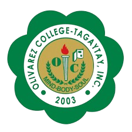
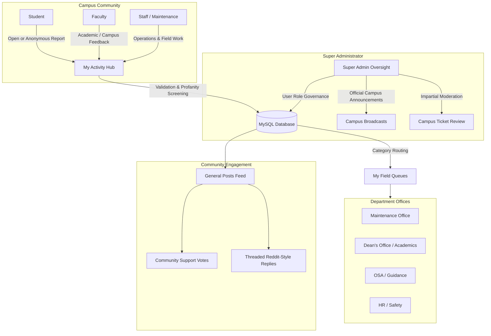
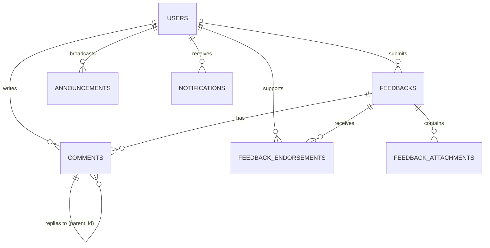

<p align="center">
  
</p>

<h1 align="center">OCT Feedback Board System</h1>

<p align="center">
  <strong>A Modern, Transparent, and Unbiased Campus Feedback & Issue Resolution Platform</strong><br>
  <em>Capstone Project tailored for Olivarez College Tagaytay (OCT)</em>
</p>

<p align="center">
  
  
  
  
</p>

---

## 📋 Overview

The **OCT Feedback Board System** is an institutional web platform that bridges communication between students, faculty, staff, and school administrative offices. It provides a secure, constructive channel for reporting campus concerns (facilities, academics, environment, safety, and behavioral matters) while ensuring that school offices (OSA, Maintenance, Dean's Office, Guidance, and HR) can inspect, track, and resolve them transparently.

To guarantee fairness and prevent conflict of interest, the system implements an **Unbiased Super Administrator Oversight Architecture** where oversight is completely detached from personal ticket creation.

---

## 🏛️ System Architecture & Workflow



---

## ✨ Key Features

### 1. 🛡️ Unbiased Multi-Role Governance (5 Baseline Roles)
- **Super Administrator (`super_admin`):** Acts as an independent, neutral overseer across all departments. Cannot submit self-serving feedback or modify their own field. Super Admin broadcasts official campus-wide announcements and oversees user permissions to eliminate conflict of interest.
- **Department Head (`admin`):** Field-specific administrator (e.g. Maintenance Office Head) who manages incoming tickets for their department, updates statuses, and assigns tasks.
- **Staff / Maintenance (`staff`):** Field responders who inspect concerns on the ground, post official updates, and resolve physical or service issues.
- **Faculty (`faculty`):** Professors and academic instructors reporting curriculum, classroom, or departmental concerns.
- **Student (`student`):** The student body, reporting facilities, environment, or academic feedback openly or anonymously.

### 2. 🌐 General Posts & Departmental "My Field" Scoping
- **General Posts (`dashboard.php`):** A full-width campus browsing feed showcasing all public, approved concerns across every category. Features keyword search, category filtering, and sorting by **Newest** or **Most Supported**.
- **My Field (`my-field.php`):** Department-filtered queue allowing maintenance staff and department heads to focus strictly on their operational jurisdiction without unrelated clutter.

### 3. 📑 "My Activity" Personal Hub (`my-activity.php`)
Consolidates personal concerns and feedback submission into a single location:
- **Interactive Status Tracker Cards:** Real-time counters (`Total submitted`, `Pending`, `Under review`, `Resolved`) with 1-click status filtering.
- **My Submitted Posts:** Complete history of all feedback you created, displaying real-time lifecycle status badges, assigned departments, and direct links to tickets.
- **Feedback Submission Form:**
  - Category selection (`Facility / Maintenance`, `Academic`, `Environment / Safety`, `Social / Behavioral`, `Others`).
  - Multi-file attachments (images, video, audio).
  - Strict profanity & explicit language filtering in English and Tagalog.
  - **"Submit as Anonymous" toggle:** Completely conceals identity from admins while preserving personal ticket tracking.

### 4. 💬 Reddit-Style Community Engagement & Discussions
- **"Support" Feature (Constructive Upvote Alternative):** Students and faculty can click **Support** on concerns that affect them too. Concerns with high community support rise to the top, showing administration where urgency lies.
- **Threaded Comment Replies:** Supports Reddit-style nested discussion trees with indentation and visual connector lines.
- **Assigned Personnel Priority Highlighting:** Replies from the assigned department head or maintenance staff are visually highlighted with an **`Assigned Personnel`** badge and brand green border to help users spot official answers instantly.
- **Author Tag (`OP`):** Distinguishes the original poster throughout the thread.

### 5. 🚥 Modern Lifecycle Progress Stepper (`ticket.php`)
Visual 3-stage lifecycle progress tracker:
```
  [1] Pending  ───────────▶  [2] Under Review  ───────────▶  [3] Resolved
  Ticket Queued             Assigned & Inspected             Issue Verified
```
- Real-time connector lines and glowing status indicators.
- Dedicated **Rejection Banner** for moderated tickets.
- Fully responsive design that adapts cleanly on mobile devices.

### 6. 📢 Official Campus Announcements (`announcements.php`)
- Super Admin broadcasts school advisories, holiday updates, and campus repairs.
- Automatically dispatches in-app notifications to all registered campus users.

---

## 🚀 Setup & Installation (XAMPP)

1. **Install XAMPP**: [apachefriends.org](https://www.apachefriends.org) (PHP 8.0+ recommended).
2. Copy this project folder into `C:\xampp\htdocs\FeedBack-Board-System`.
3. Start **Apache** and **MySQL** in the XAMPP Control Panel.
4. **Import Database**:
   - Open **phpMyAdmin** (`http://localhost/phpmyadmin/`).
   - Create a database named `oct_feedback`.
   - Go to **Import** and choose `database.sql`.
5. Open your browser: **`http://localhost/FeedBack-Board-System/`**

---

## 👥 Baseline Demo Accounts (Seeded in `database.sql`)

| Role | Name | Email | Password | Responsibility |
| :--- | :--- | :--- | :--- | :--- |
| **Super Admin** | System Administrator | `superadmin@oct.edu.ph` | `superadmin123` | Unbiased oversight, user roles & announcements |
| **Admin (Dept Head)** | Engr. Mary Grace Piattos | `marygrace.piattos@oct.edu.ph` | `admin123` | Head of Maintenance / Facility Field |
| **Staff / Maintenance** | Peter Parker | `peter.parker@oct.edu.ph` | `staff123` | Facility inspections & non-academic responder |
| **Faculty** | Prof. LeBron James | `lebron.james@oct.edu.ph` | `faculty123` | Professor / Faculty member |
| **Student** | Yel Mendoza | `yel.mendoza@oct.edu.ph` | `student123` | Student body (BS Information Technology) |

---

## 🗄️ Database Architecture



| Table | Purpose |
| :--- | :--- |
| `users` | User credentials, roles, departments, and field scopes |
| `feedbacks` | Ticket numbers, category, description, status, anonymous switch, public flag |
| `feedback_attachments` | Evidence media (images, video, audio) |
| `feedback_endorsements` | Unique community "Support" votes per ticket |
| `comments` | Threaded discussion messages with `parent_id` for nested replies |
| `announcements` | Campus-wide broadcast advisories posted by Super Admin |
| `notifications` | Real-time in-app alerts on ticket updates and replies |
| `password_resets` | Secure single-use password recovery tokens |

---

## 🔒 Security & Defense Talking Points

- **Role-Based Access Control (RBAC):** Super Admin is structurally prevented from managing personal tickets or favoring departments.
- **SQL Injection Defense:** 100% PDO prepared statements across all database interactions.
- **Cross-Site Scripting (XSS) Mitigation:** All dynamic inputs sanitized via `htmlspecialchars()` wrappers.
- **CSRF Token Verification:** Applied to all state-changing forms and AJAX endpoints (`support_toggle.php`).
- **Profanity & Content Moderation:** Strict regex word-boundary filter screening English and Tagalog explicit terms with leetspeak normalization.
- **Data Privacy Act of 2012 (RA 10173):** Explicit user consent during onboarding, secure password hashing with bcrypt, and identity protection through anonymous reporting.
